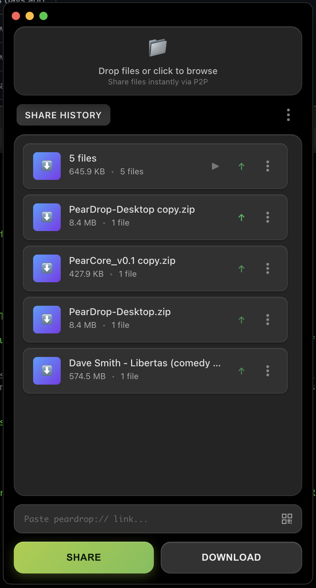
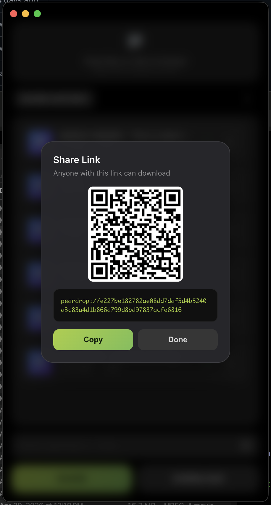
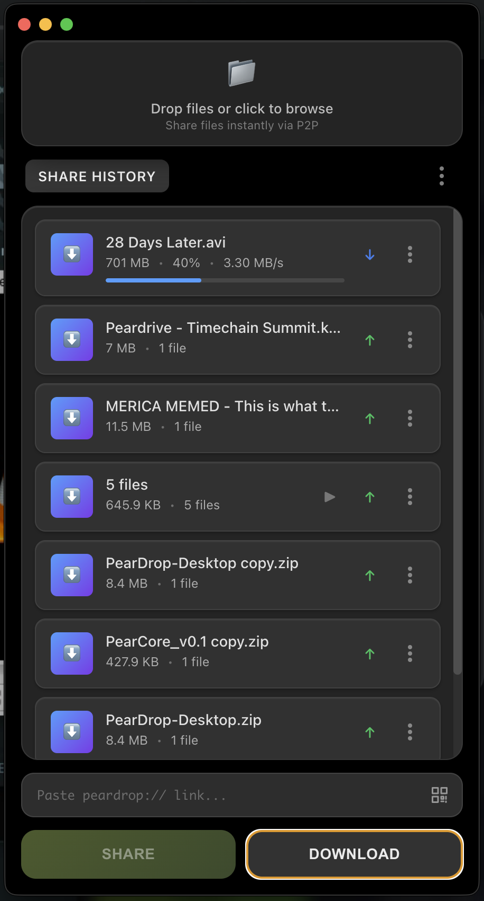
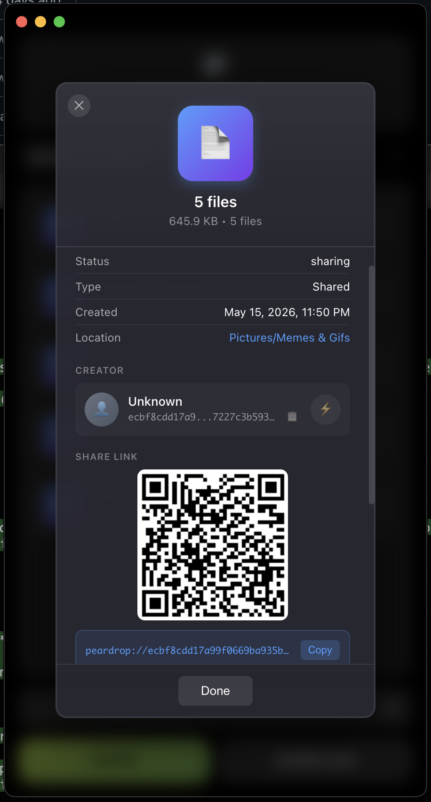
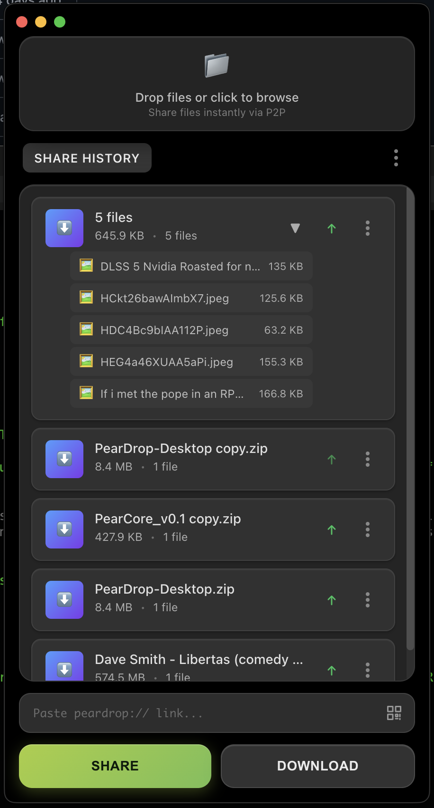

# 🍐 PearDrop

**The file sharing app that actually works the way you expect it to.**

No accounts. No limits. No bullshit. Just drop a file, get a link, send it to whoever needs it. They click it, they get the file. Done.

## 📸 See It In Action

<div align="center">
  
  
</div>

<div align="center">
  
  
</div>

<div align="center">
  
</div>

---

## 🤔 Why This Exists

Every other file sharing service:
- Requires you to create an account
- Stores your files on their servers
- Has arbitrary size limits  
- Dies when the company goes under
- Tracks everything you do

PearDrop:
- **Zero accounts** → Works immediately
- **True P2P** → Files go directly between you and them
- **No limits** → Share 50GB movies if you want
- **Unstoppable** → Decentralized, no single point of failure
- **Private** → No tracking, no data collection, no surveillance capitalism

---

## 🚀 How It Works

### Sharing Files
1. **Drag & drop** files into the app
2. Click **"SHARE"** 
3. **Copy the link** (`peardrop://abc123...`)
4. **Send it** to whoever needs the files

### Getting Files  
1. **Paste the link** into the app
2. Click **"DOWNLOAD"**
3. **Files appear** in your downloads folder

That's literally it. No registrations, no uploads to "the cloud," no waiting for some server to process your stuff.

---

## 🛠 Getting Started

### Download & Run
1. **Download** the latest release for your platform
2. **Install** and run PearDrop
3. **Start sharing** files immediately

### Build From Source
```bash
git clone https://github.com/peardrive/PearDrop-Desktop.git
cd PearDrop-Desktop
npm install
npm run app          # build + run against the public DHT
```

### Development

| Command | What it does |
|---|---|
| `npm run bootstrap` | Start a fresh local HyperDHT bootstrapper on `127.0.0.1:8787` (`-- --lan`, `-- --host <ip> --port <n>`) |
| `npm run dev` | Hot-reloading app wired to the local bootstrapper, isolated `dev` profile |
| `npm run dev:peer` | A second dev instance (`dev-peer` profile) — send files between the two |
| `npm run app` | Production build, public DHT (or the bootstrap set in Settings → Network) |
| `npm run build` | Compile main, preload and renderer into `out/` |
| `npm run build:win` / `build:mac` / `build:linux` / `build:all` | Installers into `dist/` (electron-builder) |
| `npm run build:dir` | Unpacked app — fastest packaging smoke test |
| `npm run typecheck` · `npm test` · `npm run check` | TypeScript, engine + unit tests, both |

Typical local test: `npm run bootstrap` in one terminal, `npm run dev` and `npm run dev:peer` in two more.
The CLI joins the same network with `PEARDROP_BOOTSTRAP=127.0.0.1:8787 peardrop share <file>`.

### App identity

Name, app id, description, copyright and logo live in **`app.config.json`**. The window title,
OS app name, About section and installers all read it — rebranding means editing that one file
(and replacing the PNG it points at; 1024×1024 recommended).

---

## 🔧 Technical Details

**Built on battle-tested tech:**
- **Hyperdrive** - Distributed file system from the Hypercore Protocol
- **Hyperswarm** - P2P networking that punches through NAT/firewalls
- **Electron** - Cross-platform desktop app framework
- **React + TypeScript + Tailwind** - UI, with a dark and a light theme

See [docs/ARCHITECTURE.md](docs/ARCHITECTURE.md) for how the pieces fit, including how to plug in a
different transfer backend.

**No size limits:**
- Streams files in chunks
- Works with files of any size
- Memory efficient

**Bulletproof recovery:**
- Corrupted state files auto-rebuild from drive data
- Handles network interruptions gracefully
- Persistent peer discovery (files resume downloading even after restarts)

---

## 🌍 The Bigger Picture

PearDrop is part of building a **decentralized internet** where:
- You own your data
- No company can deplatform you
- Tools work without permission from gatekeepers
- Privacy is the default, not a premium feature

This is how the internet was supposed to work.

---

## 🎨 Features

### ✅ Currently Working
- **Unlimited file sizes** - Share anything
- **Real P2P transfers** - Direct peer-to-peer connections
- **Auto-discovery** - No manual IP addresses or port forwarding
- **Cross-platform** - Windows, Mac, Linux
- **Clean UI** - Dark theme with glassmorphism design
- **Progress tracking** - See real transfer speeds and progress
- **CLI tool** - Command line interface for automation
- **QR codes** - Scan links with your phone camera

### 🔮 Coming Soon
- **Mobile apps** - iOS and Android clients
- **Folder sharing** - Share entire directories with structure
- **Resume transfers** - Pick up where you left off
- **Link expiration** - Set time limits on shares

---

## 📁 File Storage

```
~/.peardrop/
├── downloads/           # Files you receive (files you share stay where they are)
├── drives/              # P2P drive data (auto-managed)
├── drives-state.json    # Drive manifest
├── preferences.json     # Settings: theme, network bootstrap, list view, debug
├── library.json         # Favorites and display-name aliases
├── window-state.json    # Last window size/position
└── logs/                # peardrop-YYYY-MM-DD.log, last 14 days kept
```

Dev profiles live under `~/.peardrop/profiles/<name>/`. `PEARDROP_HOME` moves the whole root.
Data from older versions (`~/peardrop`) is migrated automatically on first launch; files already
downloaded there stay in place and keep opening from the app.

**Privacy note:** Files are only stored temporarily during transfer. When you stop sharing, the data gets cleaned up automatically.

---

## 🤝 Contributing

**Found a bug?** Open an issue.  
**Want to add a feature?** Fork it and send a PR.  
**Have questions?** Start a discussion.

**Code style:** We keep it simple. Follow existing patterns, add comments for complex stuff, test your changes.

**Architecture:** New features should be isolated modules (see `CLAUDE.md` for details).

---

## ⚖️ License

**GPL v3** - Because freedom should stay free.

You can use, modify, and distribute this code. If you improve it, those improvements must also be free and open source. This prevents companies from taking our work and making it proprietary.

---

## 🙏 Built With

- **[Hypercore Protocol](https://hypercore-protocol.org/)** - The P2P foundation
- **[Electron](https://electronjs.org/)** - Cross-platform desktop apps
- **Your feedback** - Keep the issues and suggestions coming

---

*Stop feeding Big Tech your data. Take back control of your files.*

**[Download PearDrop](https://github.com/peardrive/PearDrop-Desktop/releases) | [Join the Discussion](https://github.com/peardrive/PearDrop-Desktop/discussions)**
