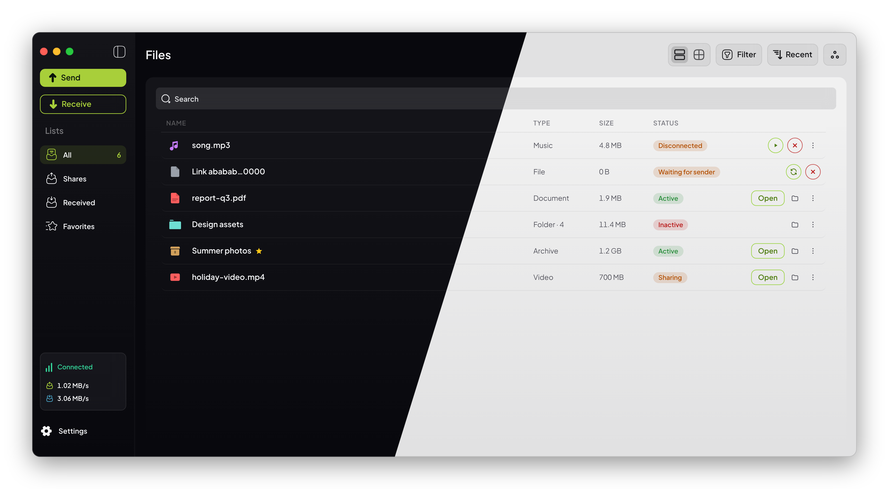

<div align="center">

# 🍐 PearDrop

**Simple, elegant peer-to-peer file sharing.**

No accounts, no cloud, no size limits. Drop a file in, send the link, and it goes straight from your computer to theirs.

[**Download**](https://github.com/peardrive/peardrop-desktop/releases/latest) · [Run from source](#-build-from-source) · [Local test network](#-local-test-network)



</div>

---

## What it does

- **Share files and folders.** Drop them in, click **Share**, and send the `peardrop://…` link (or show its QR code).
- **Receive by pasting a link** or scanning a QR code with your camera.
- **Works when the sender is offline.** A pasted link waits in your list ("Waiting for sender") and PearDrop keeps looking for the sender, even after a restart, until the download finishes.
- **Peer to peer.** Transfers run over [Hyperswarm](https://github.com/holepunchto/hyperswarm) and [Hyperdrive](https://github.com/holepunchto/hyperdrive) and punch through NATs, so nothing is uploaded to a server.
- **Runs in the background.** Closing the window keeps PearDrop in the tray (menu bar on macOS), so shares stay reachable.
- **Live network panel** with connection state and inbound/outbound speed.
- **11 themes**, or follow the system light/dark setting.

## Contents

- [Download and run](#-download-and-run)
- [Build from source](#-build-from-source)
- [Local bootstrap node](#-local-bootstrap-node)
- [Local test network](#-local-test-network)
- [Debugging](#-debugging)
- [Where data lives](#-where-data-lives)
- [Project layout](#-project-layout)

---

## 📦 Download and run

Installers for every platform are on the **[Releases page](https://github.com/peardrive/peardrop-desktop/releases)**.

| Platform | File | Notes |
|---|---|---|
| **Windows** (x64) | `PearDrop-<version>-win-x64.exe` | Installer. You can choose the install folder. |
| | `PearDrop-<version>-portable.exe` | Portable build. No install needed, just run it. |
| **macOS** (Apple Silicon) | `PearDrop-<version>-mac-arm64.dmg` | Also published as a `.zip` |
| **macOS** (Intel) | `PearDrop-<version>-mac-x64.dmg` | Also published as a `.zip` |
| **Linux** | `PearDrop-<version>-linux-<arch>.AppImage` | `chmod +x` it, then run it |
| | `PearDrop-<version>-linux-<arch>.deb` | `sudo apt install ./PearDrop-*.deb` |

> [!NOTE]
> Release builds aren't code-signed yet, so your OS may warn you the first time you open one.
> - **Windows SmartScreen:** click *More info → Run anyway*.
> - **macOS Gatekeeper:** right-click the app and choose *Open*. If macOS says the app is damaged, run `xattr -dr com.apple.quarantine /Applications/PearDrop.app`.

Once it opens, PearDrop connects to the public Hyperswarm DHT by itself. You don't need to set anything up.

---

## 🛠 Build from source

### Prerequisites

- **Node.js 20 LTS or newer**, with npm
- **Git**

You don't need a C/C++ toolchain. The native P2P modules (`sodium-native`, `udx-native`, `rocksdb-native`) come with prebuilt binaries.

### Clone, install, run

```bash
git clone https://github.com/peardrive/peardrop-desktop.git
cd peardrop-desktop
npm install
npm run app        # builds, then starts PearDrop on the public DHT
```

`npm install` also downloads the Electron binary (a `postinstall` step makes sure it's complete). If that download fails or stalls, try a mirror:

```bash
# macOS / Linux
ELECTRON_MIRROR=https://npmmirror.com/mirrors/electron/ npm run setup:electron
```
```powershell
# Windows (PowerShell)
$env:ELECTRON_MIRROR="https://npmmirror.com/mirrors/electron/"; npm run setup:electron
```

On Windows, if the download keeps failing, check that your antivirus or *Controlled Folder Access* isn't stopping Node from writing `electron.exe`.

### Package installers

```bash
npm run build:win     # NSIS installer + portable .exe
npm run build:mac     # .dmg + .zip for x64 and arm64
npm run build:linux   # AppImage + .deb
npm run build:dir     # unpacked app only. Fastest way to test packaging.
```

Output goes to `dist/`. Each command first compiles the main, preload and renderer bundles into `out/` (`npm run build`), then runs [electron-builder](https://www.electron.build/) with `electron-builder.config.cjs`.

| Building on → | Windows targets | macOS targets | Linux targets |
|---|---|---|---|
| **Windows** | ✅ | ❌ | ❌ |
| **macOS** | ✅ (needs Wine for NSIS) | ✅ | ✅ |
| **Linux** | ✅ (needs Wine for NSIS) | ❌ | ✅ |

### Checks

```bash
npm run typecheck   # TypeScript, main + renderer
npm test            # vitest (includes an engine round-trip test)
npm run check       # both
```

### App identity

The name, app id, description, copyright, link scheme and logo all come from **`app.config.json`**. The window title, OS app name, About page and installers read that file, so rebranding means editing it and replacing the logo PNG (1024×1024 recommended).

---

## 🛰 Local bootstrap node

PearDrop finds peers through a HyperDHT. Normally that's the public network, but for development, offline work or a closed LAN you can run your own **bootstrap node**:

```bash
npm run bootstrap
```

```
  🍐 PearDrop local bootstrapper running
     bootstrap node   127.0.0.1:8787
     persistent node  127.0.0.1:8788
```

This starts a fresh, private DHT with two parts: the bootstrapper on `<port>` and a persistent DHT node on `<port + 1>`, so the network has a routable member from the start. Press `Ctrl+C` to stop it.

| Option | What it does |
|---|---|
| *(none)* | Binds to `127.0.0.1:8787`. Only reachable from this machine. |
| `-- --lan` | Binds to this machine's first LAN IPv4 address so other devices can reach it |
| `-- --host <ip>` | Binds to a specific IPv4 address. `0.0.0.0` is rejected because peers can't route to it; use a real address. |
| `-- --port <n>` | Uses a different port (the persistent node takes `n + 1`) |

The `PEARDROP_BOOTSTRAP_HOST` and `PEARDROP_BOOTSTRAP_PORT` environment variables set the same defaults.

### Pointing PearDrop at it

PearDrop picks its bootstrap nodes in this order. The first one set wins:

1. **`PEARDROP_BOOTSTRAP` environment variable.** `npm run dev` and `npm run dev:peer` set it to `127.0.0.1:8787` for you.
2. **Settings → Network → Bootstrap node.** Type `host:port` (the *Use local* shortcut fills in `127.0.0.1:8787`) and click **Save & reload engine**. The setting is saved, so it also applies to `npm run app` and installed builds.
3. **Public DHT**, when neither of the above is set.

Both accept a single `host:port` or a list separated by commas or spaces, for example `192.168.1.20:8787, 192.168.1.21:8787`. If the environment variable is set, the Settings page says so. To go back to the public network, clear the field and reload the engine.

---

## 🧪 Local test network

### Two peers on one machine

The quickest way to test sending and receiving. Open three terminals:

```bash
npm run bootstrap   # terminal 1: private DHT on 127.0.0.1:8787
npm run dev         # terminal 2: peer A, "dev" profile, hot reload
npm run dev:peer    # terminal 3: peer B, "dev-peer" profile
```

Share something in one window, paste the link into the other, and the transfer runs entirely through your local DHT. Each **profile** keeps its own drives, downloads, settings and logs under `~/.peardrop/profiles/<name>/`, so the two instances never share state. Each profile allows only one running instance.

You can add more peers with any profile name:

```bash
npx cross-env PEARDROP_BOOTSTRAP=127.0.0.1:8787 PEARDROP_PROFILE=peer-3 electron-vite dev
```

### Peers across your LAN

1. On the machine that will host the DHT, start the bootstrapper on its LAN address:

   ```bash
   npm run bootstrap -- --lan
   # bootstrap node   192.168.1.20:8787
   ```

2. Let other devices reach it: allow inbound **UDP** on ports **8787 and 8788** in that machine's firewall. HyperDHT runs over UDP.

3. On every other machine, point PearDrop at that address:

   - **Installed app or `npm run app`:** open *Settings → Network → Bootstrap node*, enter `192.168.1.20:8787`, then click **Save & reload engine**.
   - **From source with hot reload:** `npm run dev` always uses `127.0.0.1:8787`, so start the dev build with your own values:

     ```bash
     npx cross-env PEARDROP_BOOTSTRAP=192.168.1.20:8787 PEARDROP_PROFILE=dev electron-vite dev
     ```

4. The sidebar's network panel shows **Online** once the engine has joined the DHT, and **Connected** while it's linked to a peer. Share on one machine and receive on another.

> [!TIP]
> If peers can't find each other, check that the machines can reach each other over UDP on the same subnet. Guest Wi-Fi and some corporate networks isolate clients. Also confirm that every peer shows the same bootstrap address under *Settings → Network*.

---

## 🐞 Debugging

### Environment variables

| Variable | Effect |
|---|---|
| `PEARDROP_BOOTSTRAP` | DHT bootstrap node(s), `host:port[, host:port]`. Overrides the setting saved in Settings. |
| `PEARDROP_PROFILE` | Isolates all state under `~/.peardrop/profiles/<name>/` so several instances can run side by side |
| `PEARDROP_HOME` | Moves the whole data root (default `~/.peardrop`) |
| `PEARDROP_WINDOW_FRAME` | `mac`, `windows` or `native`. Previews another platform's window chrome on any OS. |
| `PEARDROP_QUIT_WINDOW` | `always` shows the shutdown-progress window on every quit, not only on slow quits |

The npm scripts use [`cross-env`](https://github.com/kentcdodds/cross-env), so the same commands work on Windows, macOS and Linux. Shortcuts:

| Command | Same as `npm run dev`, plus |
|---|---|
| `npm run dev:mac` | macOS window chrome (frameless, in-app traffic lights) |
| `npm run dev:quit-window` | Always show the quit window |

### Tools

- **DevTools** open in a separate window whenever you run a `dev` script.
- **Logs** are written to `<data root>/logs/peardrop-YYYY-MM-DD.log` and kept for 14 days. Keys and your home folder path are removed before anything is written. *Settings → Diagnostics* can open the folder or copy the last 300 lines.
- **Verbose console output** (*Settings → Diagnostics*) also prints debug-level lines to the terminal.
- **Settings → Network** shows the engine's state, which bootstrap nodes are in use and where they came from. **Reload engine** restarts the P2P engine without restarting the app.

---

## 📁 Where data lives

```
~/.peardrop/                  # or $PEARDROP_HOME
├── downloads/                # files you receive (files you share stay where they are)
├── drives/                   # P2P drive data, one Corestore per drive
├── drives-state.json         # the engine's list of drives
├── preferences.json          # theme, bootstrap node, list view, background, diagnostics
├── library.json              # favorites and display names
├── receive-queue.json        # pasted links still waiting for their sender
├── window-state.json         # last window size and position
├── logs/                     # daily logs, last 14 days
└── profiles/<name>/          # same layout, one folder per PEARDROP_PROFILE
```

Data from versions before 0.29 (`~/peardrop`) is migrated automatically on first launch.

---

## 🗂 Project layout

```
src/
├── main/        Electron main process: windows, tray, IPC, stores, services
├── preload/     contextBridge API exposed to the renderer
├── renderer/    React + Tailwind UI (themes in renderer/theme/themes.ts)
├── engine/      P2P engine (Hyperdrive/Hyperswarm), bundled into main
└── shared/      Types and helpers used by main and renderer
scripts/         bootstrapper.mjs, ensure-electron.cjs
test/            engine tests (vitest)
```

Built with Electron, electron-vite, React, TypeScript, Tailwind CSS and Zustand on top of the [Holepunch](https://holepunch.to) stack.

---

## 🤝 Contributing

Bug reports and pull requests are welcome. Before opening a PR, run `npm run check`. For networking changes, also test with the [two-peer local setup](#two-peers-on-one-machine).

## ⚖️ License

[MIT](LICENSE) © 2026 Anjou
